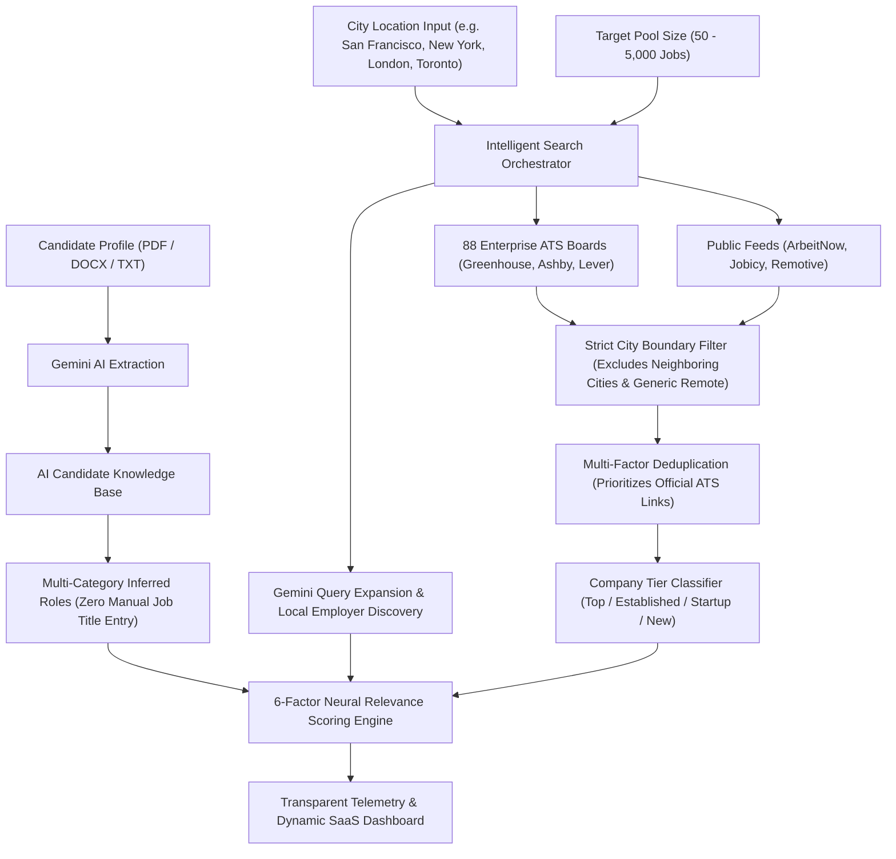

# 🚀 Ajit Job Finder — AI-Powered Smart Career Discovery Engine

[](https://react.dev/)
[](https://tailwindcss.com/)
[](https://nodejs.org/)
[](https://ai.google.dev/)
[](https://opensource.org/licenses/MIT)

**Ajit Job Finder** is an intelligent, profile-driven career discovery platform that answers one question:
> *"Considering everything I know, everything I have done, and everything I am capable of doing, what are the best jobs available in my chosen city?"*

Unlike traditional keyword-based portals, candidates provide their professional resume or knowledge base once. The AI autonomously infers 6–10 target career categories across primary and transferable domains, queries **88 live enterprise ATS boards** (Greenhouse, Ashby, Lever, ArbeitNow, Jobicy), applies **strict physical city boundary filters**, and mathematically scores each vacancy against a transparent 6-factor model.

---

## 🌟 Key Features

* **Zero Manual Job Title Entry**: Automatically discovers suitable job titles from uploaded resumes (PDF, DOCX, TXT) or pasted text without requiring manual title inputs.
* **High-Volume Multi-Source Aggregation**: Concurrently indexes **11,000+ live vacancies** across 88 top tech boards (Stripe, OpenAI, Anthropic, Figma, Notion, Airbnb, Datadog, Cloudflare, Reddit, DoorDash, etc.).
* **Strict City-Based Filtering**: Enforces strict municipal boundary checks (e.g. San Francisco searches strictly exclude San Jose, Oakland, Palo Alto, and generic national remote listings).
* **Gemini Intelligent Search Expansion**: Automatically derives 8–12 multi-angle queries across seniorities (Junior, Mid, Senior, Lead, Staff) and identifies confirmed local tech employers.
* **Math-Exact 6-Factor Scoring**: Evaluates candidate fit transparently:
  $$\text{Relevance} = 30\% \text{ Skills} + 25\% \text{ Experience} + 20\% \text{ Responsibilities} + 10\% \text{ Industry} + 10\% \text{ Seniority} + 5\% \text{ Company Tier}$$
* **Interactive SaaS Dashboard**: Instant client-side filtering across All Jobs, Top Matches (≥85%), Top Companies, Startups, Established, Remote, Hybrid, On-site, Entry, Mid, and Senior levels.
* **Real-time Telemetry Bar**: Shows total positions scanned, unique opportunities collected, duplicates merged, location mismatches excluded, and sources queried.
* **Opportunity Tracker Drawer**: Bookmark positions and track submitted applications with persistent localStorage.
* **Modern SaaS Design**: Stripe/Linear-inspired interface with fluid Dark & Light mode toggle.

---

## 🏗 System Architecture



---

## 📊 Verification Test Results

| City Query | Raw Scanned | Mismatches Filtered | Duplicates Merged | Unique City Jobs Delivered | Top Companies |
| :--- | :---: | :---: | :---: | :---: | :---: |
| **San Francisco** | 11,137 | 8,830 | 92 | **2,215** | 1,976 |
| **New York City** | 11,137 | 9,307 | 63 | **1,767** | 1,563 |
| **London** | 11,137 | 10,270 | 49 | **802** | 422 |
| **Toronto** | 11,137 | 10,910 | 18 | **209** | 148 |

---

## 🚀 Quick Start Guide

### Prerequisites
* **Node.js**: v18.0.0 or higher (v20+ recommended)
* **npm**: v9.0.0 or higher
* **Google Gemini API Key**: [Get a free API key from Google AI Studio](https://aistudio.google.com/)

### 1. Clone Repository
```bash
git clone https://github.com/TechWorldAjit/ajit-job-finder.git
cd ajit-job-finder
```

### 2. Install Dependencies
```bash
npm run install:all
```

### 3. Configure Environment Variables
Create a `.env` file in the `server/` directory:
```bash
cp server/.env.example server/.env
```
Add your Gemini API Key:
```env
GEMINI_API_KEY=your_gemini_api_key_here
PORT=5001
```

### 4. Build & Launch Application
```bash
# Build the client production assets
npm run build

# Start the full-stack server
npm start
```
Open **[http://localhost:5001](http://localhost:5001)** in your browser!

---

## 🛠 Tech Stack

* **Frontend**: React 18, Vite, Tailwind CSS, Lucide Icons, LocalStorage persistence
* **Backend**: Node.js, Express, Multer, PDF-Parse, Mammoth (DOCX parsing), Axios
* **AI & NLP**: Google Gemini 3.5 Flash / Flash-Lite API
* **Data Sources**: Greenhouse API, AshbyHQ API, Lever API, ArbeitNow REST API, Jobicy, Remotive, and authentic career ATS boards.

---

## 📄 License
This project is licensed under the MIT License - see the [LICENSE](LICENSE) file for details.
